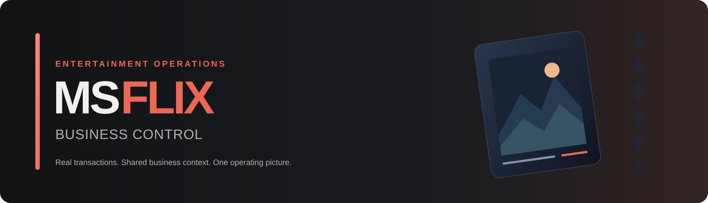
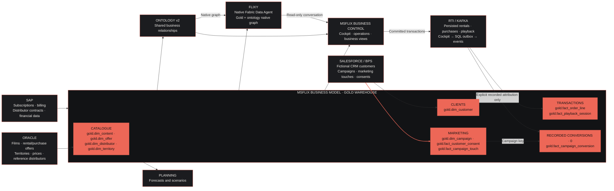

<p align="center">
  
</p>

<p align="center">
  <strong>Entertainment operations, grounded in actual business activity.</strong><br>
  Oracle · Salesforce · SAP · Kafka / RTI · Microsoft Fabric · Planning · Ontology v2 · Rayfin
</p>

# MSFlix Business Control

A shared view of the entertainment business: films and offers, fictional CRM
audiences, actual demonstration rentals, purchases and playback. The cockpit
executes transactions; the business model consolidates them; Ontology connects
their customer, campaign, content and commercial relationships.

https://github.com/user-attachments/assets/226308ce-ce07-4e5a-ba60-c2cd0478adc2

## Where the Gold business tables come from

Overall MSFlix business architecture, with source-to-table lineage.



`content_key`, `customer_key`, `offer_key` and `campaign_key` link the same
business entities across sources, Gold and Ontology.

Clients, campaigns, consents and marketing touches reach Gold through native BPS.
Recorded conversions remain **0**: none are invented.

**Verified backbone:** actual Task Flow **9 tasks / 12 connectors / 47
assignments**, Gold **1,008 demonstration orders**, and a live Gold-backed
Ontology graph. The cockpit combines a cinematic film-led home, business views
and an interactive graph with visible relationships, zoom and node selection.

**MSFlix Insights**, immediately below Business Graph, joins published Gold
orders, Oracle catalogue, Salesforce customer context and associated RTI playback.
A shared date, territory, genre, transaction and currency selection drives the
daily charts, territory/genre heatmap and film ranking. Amounts stay separated
by currency; the source panel identifies unpublished integrations, including SAP.
See the [dashboard definitions](docs/COCKPIT.md#msflix-insights) for the cohort
and source boundaries.

The **Demo tab** generates bounded, real business transactions through the same
application commands. A persistent cloud worker publishes their events to Kafka,
then refreshes Raw, Silver, Gold and the ontology graph. Its accepted checkpoint
contains **13,477 propagated events**. Analytics refresh is asynchronous, not an
instantaneous consequence of clicking a command.

**Flixy** is available from its floating bubble on every cockpit tab, connected
to the native Fabric Data Agent for Gold and the ontology's real relationships.
Microsoft currently blocks direct ontology-v2
attachment, so its supported **native graph** is used instead. Access is
identity-scoped; see [Flixy](docs/FLIXY.md) for the source and authentication details.

## Run it

Open the [MSFlix cockpit](https://<app-host>)
with an authorized identity. For deployment or replay, use the
[source and execution documentation](docs/ARCHITECTURE.md); run only the needed
stage against the approved environment, never reset existing source data.

## Deep dives

[Architecture](docs/ARCHITECTURE.md) · [Oracle](docs/ORACLE.md) ·
[Salesforce / BPS](docs/SALESFORCE-BPS.md) · [RTI](docs/RTI.md) ·
[Warehouse → Ontology](docs/WAREHOUSE-ONTOLOGY.md) ·
[Workspace Task Flow and folders](docs/TASK-FLOW.md) · [Cockpit](docs/COCKPIT.md) ·
[Automatic Demo propagation](docs/DEMO-AUTOMATION.md) · [Flixy](docs/FLIXY.md)

[SAP local data contract](docs/IMPLEMENTATION-PLAN.md#sap-pr-1-local-data-contract):
the separately developed, synthetic subscription/billing/content-contract scenario
retains its local-only generator. The [native SAP integration](docs/IMPLEMENTATION-PLAN.md#sap-native-bps-and-warehouse-publication)
adds a separately authorized private Datasphere landing, native SAP mirroring and
isolated BPS processing. The first qualified native Gold scenario is now published
in `MSFlixGold`: 22 SAP domain tables, nine serving views and separate SAP freshness.
The synthetic November 2026 case reports EUR 28 net revenue, EUR 13.60 content
expense and EUR 14.40 contribution after content cost only. Every subsequent
publication still requires actual native Silver/Gold qualification; neither
Planning nor cockpit changes are included.

Customer identities are fictional. No real bank charge or commercial
film-distribution right is claimed. Sourced imagery retains its individual
license; original editorial imagery is never presented as an official poster.
See [catalog provenance](data/catalog.sources.json).

<details>
<summary>Refresh the operational Warehouse</summary>

Oracle Mirroring runs continuously. New Demo transactions propagate automatically;
this sequence is for a **complete source/master refresh**. Pause the automatic
worker first and wait for its current cycle to finish; follow the
[automation runbook](docs/DEMO-AUTOMATION.md) before resuming it with the updated
master configuration. Kafka broker ACKs and exact event coverage must precede
analytics publication; native OneLake availability has a **five-minute target**,
not a guaranteed maximum delay.

1. Complete **Salesforce native BPS extraction → native B2S/Silver**. Salesforce
   native BPS Gold is optional for this operational refresh.
2. Export/stage the **processed BPS snapshots through our CLI**, following the
   [native-source handoff](docs/SALESFORCE-BPS.md).
3. Run **MSFlixRawProcessing before MSFlixSilverProcessing**:
   `--stage process` runs both automatically in that order.
4. Load **Gold through the CLI**, not a Gold notebook.
5. Refresh the **Gold-backed Ontology graph**.

```powershell
py -3 -m fabric.deploy --config fabric\config.live.local.json --stage process
py -3 -m fabric.deploy --config fabric\config.live.local.json --stage gold
py -3 -m scripts.refresh_ontology_graph
```

Full prerequisites and source commands are in the
[BPS](docs/SALESFORCE-BPS.md), [RTI](docs/RTI.md) and
[Warehouse](docs/WAREHOUSE-ONTOLOGY.md) deep dives. The native BPS Touch/facts
relationship gate is separate; it does not block loading its processed Silver
data into this Warehouse. SAP uses its own
[native-Gold-only publication](docs/IMPLEMENTATION-PLAN.md#sap-native-bps-and-warehouse-publication);
the operational refresh neither replaces SAP tables nor advances `gold.sap_publication`.

</details>
