# MSFlix architecture

**Deployment:** MSFlix workspace `<WORKSPACE_ID>`,
active F16 `<capacity-name>`, Southeast Asia / Singapore.
Extended live inventory and folder readback: **2026-10-07 20:01 UTC**.
Automatic propagation acceptance: **2026-10-08 06:19 UTC**.
The workspace description is blank.

MSFlix separates three responsibilities: sources describe the business,
operational functions execute it, and Fabric consolidates the resulting state.
A thousand playback updates are not a thousand sales.

## Logical architecture mapped to deployed components

This is the overall MSFlix business architecture, **not a deployment-status
diagram**. SAP and Planning use the same presentation as the other business
components. Actual deployed artifacts and execution qualifications are recorded
below. A real Fabric Task Flow is a navigation/design surface, not an execution
engine; its actual deployment proof is documented in
[TASK-FLOW.md](TASK-FLOW.md).

```mermaid
flowchart LR
  Oracle["Private Oracle Free<br/>References"] --> Mirror["MSFlix_OracleMirror<br/>Gateway + CDC"]
  Salesforce["Salesforce"] --> BPS["Native MSFlix BPS<br/>Customers · campaigns · consents · touches"]
  Mirror -->|"Five Raw shortcuts"| Raw["MSFlixRaw"]
  BPS -->|"Processed native Silver snapshots"| Raw

  App["MSFlix Business Control<br/>Rayfin cockpit"] --> Functions["Trusted functions"]
  Functions --> SQL["App-linked SQL<br/>Orders · rights · outbox"]
  SQL --> Worker["Persistent managed-identity worker"]
  Worker -->|"Committed events + broker ACK"| Kafka["Event Hubs<br/>Kafka endpoint"]
  Kafka --> Stream["MSFlixIngress<br/>Eventstream relay"]
  Stream --> KQL["MSFlixEventhouse / MSFlixEvents<br/>RawEvents"]
  KQL --> Availability["Native OneLake availability<br/>Five-minute target"]
  Availability -->|"Deduplicated physical events"| Raw

  Raw -->|"Strict validation + normalized dates/times"| Silver["MSFlixSilver<br/>Conformance + quarantine"]
  Silver -->|"Publication-gated load"| Gold["MSFlixGold<br/>Six business areas"]
  Gold -->|"Gold facts + relationship junctions"| Ontology["MSFlixBusiness<br/>Ontology v2 + native graph"]
  Gold -->|"Real SQL analytics"| App
  Ontology -->|"Actual GQL relationships"| App
  Gold --> Flixy["Flixy<br/>Native Fabric Data Agent"]
  Ontology -->|"Native graph source"| Flixy
  Flixy -->|"Read-only conversation"| App

  SAP["SAP<br/>Subscriptions · billing<br/>Distributor contracts · financial data"] -->|"Source contracts"| Raw
  Gold --> Planning["Fabric Planning<br/>Forecasts and scenarios"]
  Planning -->|"Governed plan versions"| Gold

  classDef stage fill:#1B1C1F,stroke:#ED6757,color:#F3F0EC;
  class Oracle,Mirror,Salesforce,BPS,App,Functions,SQL,Worker,Kafka,Stream,KQL,Availability,Raw,Silver,Gold,Ontology,Flixy,SAP,Planning stage;
```



The Eventstream remains the required relay. There is **no qualified direct
Kafka-to-Eventhouse path**, no claimed healthy direct Eventstream-to-Raw branch,
and no deployed standalone semantic model in the discovered inventory.

## What happens to the data

| Stage | Physical responsibility | Current qualification |
|---|---|---|
| Oracle references | The private source mirrors five reference tables; Raw exposes them through native shortcuts. | Mirror/Raw counts agree; committed insert, update and delete were observed. |
| Salesforce BPS CRM | The activated native dataset `MSFlixCRM`, source `MSFlixSF`, owns its Bronze/Silver/Gold pipeline family. | 700 customers, 6 campaigns, 700 consents and 600 touches qualified from native Silver and loaded into MSFlix Gold. Optional BPS-native Touch Gold needs dataset relationships. |
| RTI transactions | Committed SQL outbox → persistent bounded worker → Event Hubs → Eventstream → KQL `RawEvents` → native OneLake. | 13,458 propagated IDs; all three automatic acceptance events observed through the native route. Failed direct Raw branch removed; remaining stream nodes Running. |
| Raw | Source trace, reference visibility, quarantine and physical `raw.events_ingress`. | Native references processed; deduplicated Raw includes the three latest acknowledged acceptance events. |
| Silver | Deduplication, source sequences, tombstones, shared keys and relationship integrity. | Date normalization and SQL seven-digit timestamp handling corrected/persisted; the first connected-events Gold publication succeeded. |
| Warehouse Gold | Current business facts and exact amounts, grouped into catalogue/offers/audiences/sales/playback/marketing. | Native master refresh completed, including corrected Oracle titles. The automatic acceptance published 1,003 order lines and the target playback. |
| Ontology v2 | Gold business entities and junction-backed relationships; native graph/Eventhouse children belong to this workload. | Gold binding and the 10-entity/12-relationship projection accepted; native Gold-backed graph queries succeeded. |
| Cockpit Apps | Authenticated app, trusted commands, native SQL persistence/functions and Gold analytics reads. | Cinematic home, interactive graph, Demo controls, recovered artwork and current-event ordering deployed; native user health, Gold and graph calls succeeded. |
| Flixy | Native Data Agent, Gold and the ontology-owned GraphModel, source-grounded read-only answers. | Native agent published; real Gold counts and a graph path returned. Direct ontology-context attachment remains blocked by Microsoft; the native graph is the explicit supported alternative. |

For detailed facts, see [Oracle](ORACLE.md), [Salesforce BPS](SALESFORCE-BPS.md),
[RTI](RTI.md) and [Warehouse/Ontology](WAREHOUSE-ONTOLOGY.md).

## Business consolidation, not infrastructure metrics

| Business area | Meaning in the company |
|---|---|
| Catalogue | Which sourced films, distributors and territories are known? |
| Offers | Which configured rental/purchase offers and price policies apply? |
| Audiences | Which fictional CRM identities and qualified consents can be joined? |
| Sales | Which current orders were persisted, at what exact currency amount? |
| Playback | Which actual sessions and latest positions belong to those orders? |
| Marketing | Which campaigns, touches and explicitly recorded conversions exist? |

These are functional areas over the `gold.*` implementation, not six
already-deployed SQL schemas. Gold contains customer-consent and campaign-touch
facts plus 12 relationship junctions, so Ontology and the cockpit share the
consolidated business layer. See the
[domain mapping](WAREHOUSE-ONTOLOGY.md) for the physical tables and relationships.

## Physical organization and workload boundaries

Nine real folders now contain **46 of 47 physical items**. SQL endpoints,
native cockpit children and Ontology/Eventhouse children moved automatically
with their parents; no child was moved independently.

The authorized `02 Salesforce BPS` folder contains **24 native artifacts** and
`08 Cockpit` contains **all 4 cockpit items**. Names, IDs and connections are
unchanged. The native BPS solution launcher itself remains at root because the
documented move operation returned **404 EntityNotFound** for its public item
ID; it was not renamed or replaced. BPS internal Bronze/Silver/Gold are not substitutes for the
separate cross-business `MSFlixRaw`, `MSFlixSilver` and Warehouse `MSFlixGold`.
The full **47-item** inventory and all folder IDs are in [TASK-FLOW.md](TASK-FLOW.md).

The **actual native Task Flow is now persisted**: 9 tasks, 12 connectors and
47 unique physical-item assignments, confirmed by service readback. Flixy's
extension preserved all eight earlier tasks and 46 assignments. The
workspace-specific API host resolved the earlier generic-cluster routing error;
the original empty flow list was backed up and the assignment update used ETag
concurrency.

## Security and commercial boundaries

- Oracle `<oracle-private-ip>` and gateway `<gateway-private-ip>` are private Singapore VMs.
  Gateway **registration** is in tenant-default `centralus`; this does not move
  the VM or capacity.
- Fabric private endpoint `<workspace-private-endpoint>` is Approved; API
  `<workspace-api-private-ip>` and OneLake `<onelake-private-ip>` connectivity was tested from the gateway.
  Public access remains **Allow**: the deployment is not fully private.
- The other environment's <other-environment-gateway-name>/<other-environment-connection-name> are out of scope and
  untouched. Credentials/configuration stay external or ignored.
- Exact minor-unit amounts remain separated by currency. No bank charge,
  royalty settlement, financial margin or commercial distribution right is
  invented.
- SAP and Planning are part of the overall architecture. The initial workstream
  provisioned neither and claims no qualified SAP/Planning data. The separately
  authorized SAP storage and native Fabric foundation is described below;
  data processing and Warehouse publication belong to the separate SAP finance
  change set. The user subsequently authorized Flixy and enabled the required
  Azure OpenAI cross-region processing and conversation-storage settings.
- In-cockpit Flixy requires an enabled, administrator-managed, caller-scoped
  `FlixyAccessGrant` (owner and named approved approved operator account only). The shared
  `ctx.Tokens.Fabric` identity is the app owner; caller and owner OIDs may differ,
  but their tenants must match. Native resource access uses the owner's Fabric
  permissions, not approved operator's own permissions. `OperatorGrant` is independent of
  Flixy access. See [Flixy](FLIXY.md) for the approved shared-identity model.
- The persistent worker uses managed identity, not cached administrator tokens.
  Its orchestration role is limited to MSFlix; effective SQL DENYs protect
  operational payloads, deletes and commercial writes. See the
  [automation runbook](DEMO-AUTOMATION.md) for the scope tradeoff and controls.
- GPU acceleration is a qualification gate, not a deployed business dependency;
  no `is_accelerated = 1` evidence is claimed.

## SAP Azure storage foundation

On 8 October 2026, approved operator authorized the Azure SAP foundation independently of
the local data-generator PR. app owner retains ownership of merges. Infrastructure
changes are on the separate `work/sap-mirroring` branch, based on `main`,
without merging or changing PR 1.

| Resource | Configuration |
|---|---|
| Account | `<sap-storage-account>`, `<resource-group>`, Southeast Asia |
| Storage | StorageV2, ADLS Gen2 hierarchical namespace, Standard LRS, Hot |
| Container | `datasphere`, private |
| DFS endpoint | `https://<sap-storage-account>.dfs.core.windows.net/` |
| Authentication | Microsoft Entra; shared keys disabled |
| Public access | Public network access disabled; anonymous blob access disabled |
| Network exception | Only the existing MSFlix workspace resource-instance rule; no IP/VNet rules or blanket trusted-service bypass |
| Workspace identity | Account-scoped Storage Blob Data Reader plus Storage Blob Data Contributor on the `datasphere` container only |
| Authorized operator | approved operator: Storage Blob Data Contributor, scoped to this dedicated account |

The account has HTTPS-only access, TLS 1.2 minimum and Microsoft-managed
encryption. This is **trusted workspace access**, not a newly deployed private
endpoint. The existing workspace Private Link, VNet, VMs, gateway, Event Hubs,
capacity and Salesforce BPS resources are unchanged. No credentials or storage
keys are produced by the template.

Account-level data roles are limited to this newly isolated SAP storage account
and follow the documented trusted-workspace-access authorization requirements.
The workspace identity can read the account and publish only inside the
`datasphere` container through the OneLake shortcut. That container-scoped write
grant was added during native SAP setup to create the required `S4M` directory
and support the intended publication route without opening the firewall.
If another connection identity is chosen, its permissions
must be reviewed explicitly; the template does not grant all workspace users
storage access.

The source is `infra\sap-datasphere.bicep`. Copy the example parameters to an
ignored local file and populate the approved workspace/identity IDs. Do not
deploy placeholder parameters or reuse an account owned by another workload.
Use the existing deployment policy for subscription, tenant, region and group.

```powershell
$policy = Get-Content fabric\target-policy.json -Raw | ConvertFrom-Json
$parameters = '@.state\sap-azure\parameters.private.json'
az bicep build --file infra\sap-datasphere.bicep `
  --outfile .state\sap-azure\template.json
az deployment group validate --subscription $policy.subscription_id `
  --resource-group $policy.resource_group `
  --template-file .state\sap-azure\template.json --parameters $parameters
az deployment group what-if --subscription $policy.subscription_id `
  --resource-group $policy.resource_group `
  --template-file .state\sap-azure\template.json --parameters $parameters
```

Before execution, require a preview limited to this dedicated storage account,
its blob service/container, the two expected account-scoped data grants and the
workspace identity's container-scoped writer grant.
Never apply a preview that changes existing MSFlix components or widens network
access without separate approval. Deployment uses incremental mode:

```powershell
az deployment group create --subscription $policy.subscription_id `
  --resource-group $policy.resource_group --mode Incremental `
  --name <sap-foundation-deployment> `
  --template-file .state\sap-azure\template.json --parameters $parameters
```

The deployment and management-plane readback succeeded. Parameters, previews and
readback evidence remain in ignored `.state\sap-azure`; generated SAP source
data is not uploaded by this deployment.

### Fabric SAP entrypoint

The following dedicated Fabric resources were created on 8 October using
approved operator's identity and the public Fabric APIs:

| Resource | Identifier / placement |
|---|---|
| Folder `02bis SAP BPS` | `<SAP_FOLDER_ID>` |
| Lakehouse `MSFlixSAPLanding` | `<SAP_LANDING_LAKEHOUSE_ID>`, in the SAP folder |
| Landing SQL endpoint | `<SAP_LANDING_SQL_ENDPOINT_ID>`, provisioned successfully |
| Connection `MSFlixSAPADLSRead` | `<SAP_ADLS_CONNECTION_ID>`, AzureDataLakeStorage, WorkspaceIdentity |
| Shortcut | `Files/datasphere` -> `https://<sap-storage-account>.dfs.core.windows.net/datasphere` |
| Native BPS item `MSFlixSAP` | `<SAP_BPS_ITEM_ID>`, type `Microsoft.WaaS.BusinessProcessSolutions` |

The ADLS connection uses the discovered `AzureDataLakeStorage` creation method,
with `server=<sap-storage-account>.dfs.core.windows.net` and `path=/datasphere`.
`skipTestConnection=false`; the connector only advertises the API's
`NotEncrypted` enum, but its actual endpoint is HTTPS and storage requires TLS.
The shortcut was created with conflict policy `Abort`, not overwrite.

A real OneLake directory-list read initially returned an empty `paths` array.
Native BPS setup then required the `S4M` subdirectory to exist. The workspace
identity received a Blob Data Contributor grant on this container only; a
conditional create through `Files/datasphere/S4M` returned HTTP 201, and readback
confirmed the empty directory. No business files were uploaded. Workspace roles,
storage public-access settings and existing network exceptions are unchanged.

The native BPS item was successfully created through `POST /v1/workspaces/{id}/items`.
Its documented move operation returned `EntityNotFound`, as with the existing
Salesforce BPS launcher, so this item remains at workspace root. Its landing
lakehouse and SQL child are correctly grouped in `02bis SAP BPS`.

### Native SAP BPS source and mirror

After approved operator completed interactive sign-in, the native portal created the
`MSFlixSAPFabricSQL` OAuth connection (`<SAP_SQL_CONNECTION_ID>`,
type `FabricSql`). No tokens/passwords were copied into code, evidence or browser
storage by the deployment scripts. Use the native UI for this OAuth flow; the
public create-connection request has no OAuth2 credential input.

Inside **MSFlixSAP > Configure source system > New source system**, the deployed
settings are SAP / `S4M` / SAP S/4HANA / SAP S/4HANA 2023 / SAP Datasphere, storage
connection `MSFlixSAPADLSRead`, SQL connection `MSFlixSAPFabricSQL`, and relative
container path **`datasphere/S4M`**. This version is a simulation template profile,
not a claim that a real S/4HANA system is connected. The corresponding input
shape is in `sources\sap\bps\source-system.example.json`; it documents the native
form, not an independently supported public source-provisioning API.

The first submission returned `ShortcutCreationFailed` because the source
directory was absent. After the empty directory was created, native **Edit >
Update** resumed the existing source; no source or native item was deleted.
The source eventually reported **Succeeded**.

BPS provisioned the resource family with suffix **`<SAP_SYSTEM_SUFFIX>`**:

| Type | Count |
|---|---:|
| Data pipelines | 7 |
| Notebooks | 15 |
| Lakehouses (Bronze/Silver/Gold) | 3 |
| Environment | 1 |
| SQL metadata database | 1 |
| Native SAP mirrored database | 1 |
| SQL endpoints | 5 |

At the foundation checkpoint, all **33 native items** were in `02bis SAP BPS`,
together with the two landing items: **35 items in the folder**, before later
processing-recovery additions. Only the 28 native parents were moved; their
five SQL endpoints followed automatically. Native IDs and names were preserved,
no active SAP pipeline was found during placement, and Salesforce's resource
family was not moved. The BPS launcher itself remains at root as noted above.

The only SAP mirror is BPS-created
`bps_mirrored_sap_db_S4M_<SAP_SYSTEM_SUFFIX>`
(`<SAP_MIRROR_ID>`). Its public definition reports:

- Source type `SAP`, subtype `Datasphere`.
- Landing lakehouse: native Bronze `<SAP_BRONZE_LAKEHOUSE_ID>`.
- Root `Files/S4M`, backed by its native ADLS shortcut to `/datasphere/S4M`.
- Delta target, `enableDeltaChangeDataFeed=true`, retention 30 days.

At the 8 October foundation checkpoint, the mirror reported **Running**, with
**zero tables** because no source files had been published. The native environment
was provisioned on runtime **2.0**, unchanged by this infrastructure change.
No business-processing job was manually started in that phase. Native provisioned
artifacts alone are not proof of data readiness or a successful data cycle.

The separately approved finance phase completed on 9 October: 93 SAP mirror
tables were replicating, native Silver/Gold was processed, and 22 domain tables
plus nine views were published into `MSFlixGold`. That phase also recovered the
SAP environment to runtime 1.3 for library compatibility; the infrastructure
template does not configure runtime. Its processing code, accounting gates and
SQL consumption contract belong to `work/sap-bps-finance`.
Do not upload the PR1 partial source projection as if it were already BPS-ready.

Direct storage access from a workstation is intentionally blocked by the storage
network policy, even when that user has Azure Owner or a data role.

For repeat Fabric setup, confirm the workspace identity's required Fabric role
and use a supported connection creation experience. Organizational-account
connections to firewall-protected storage should be created through the shortcut
or pipeline experience; a connection test from Manage connections and gateways
can report Offline. Do not resolve that by enabling public storage access.

See [trusted workspace access](https://learn.microsoft.com/en-us/fabric/security/security-trusted-workspace-access)
and [SAP mirroring via Datasphere](https://learn.microsoft.com/en-us/fabric/mirroring/sap-datasphere-tutorial).

## Evidence and source of truth

This document combines live Fabric inventory/folder readback, the bounded Oracle
CDC proof, and the parent/sibling's explicitly supplied RTI/BPS checkpoints.
Ignored operational evidence is not copied wholesale into source control.

- [Approved implementation plan](IMPLEMENTATION-PLAN.md)
- [Private network evidence and controls](NETWORK.md)
- [Fabric Task Flow semantics](https://learn.microsoft.com/en-us/fabric/fundamentals/task-flow-overview)
- [Documented native parent/child moves](https://learn.microsoft.com/en-us/rest/api/fabric/core/items/move-item)
- Repository implementations: `fabric/spark_runtime.py`, `fabric/gold/`,
  `fabric/rti/`, `fabric/ontology/definition/`, `services/publisher/`.
