# MSFlix architecture

**Deployment:** MSFlix workspace `d9c835a9-16d2-4997-9969-16cc4389a7c7`,
active F16 `msflixf16sea`, Southeast Asia / Singapore.
Extended live inventory and folder readback: **2026-10-07 20:01 UTC**.
Automatic propagation acceptance: **2026-10-08 06:19 UTC**.
The workspace description is blank.

MSFlix separates three responsibilities: sources describe the business,
operational functions execute it, and Fabric consolidates the resulting state.
A thousand playback updates are not a thousand sales.

## Logical architecture mapped to deployed components

This is the overall MSFlix business architecture, **not a deployment-status
diagram**. SAP and Planning use the same presentation as the other business
components. Actual deployed artifacts and execution qualifications are recorded
below. A real Fabric Task Flow is a navigation/design surface, not an execution
engine; its actual deployment proof is documented in
[TASK-FLOW.md](TASK-FLOW.md).

```mermaid
flowchart LR
  Oracle["Private Oracle Free<br/>References"] --> Mirror["MSFlix_OracleMirror<br/>Gateway + CDC"]
  Salesforce["Salesforce"] --> BPS["Native MSFlix BPS<br/>Customers · campaigns · consents · touches"]
  Mirror -->|"Five Raw shortcuts"| Raw["MSFlixRaw"]
  BPS -->|"Processed native Silver snapshots"| Raw

  App["MSFlix Business Control<br/>Rayfin cockpit"] --> Functions["Trusted functions"]
  Functions --> SQL["App-linked SQL<br/>Orders · rights · outbox"]
  SQL --> Worker["Persistent managed-identity worker"]
  Worker -->|"Committed events + broker ACK"| Kafka["Event Hubs<br/>Kafka endpoint"]
  Kafka --> Stream["MSFlixIngress<br/>Eventstream relay"]
  Stream --> KQL["MSFlixEventhouse / MSFlixEvents<br/>RawEvents"]
  KQL --> Availability["Native OneLake availability<br/>Five-minute target"]
  Availability -->|"Deduplicated physical events"| Raw

  Raw -->|"Strict validation + normalized dates/times"| Silver["MSFlixSilver<br/>Conformance + quarantine"]
  Silver -->|"Publication-gated load"| Gold["MSFlixGold<br/>Six business areas"]
  Gold -->|"Gold facts + relationship junctions"| Ontology["MSFlixBusiness<br/>Ontology v2 + native graph"]
  Gold -->|"Real SQL analytics"| App
  Ontology -->|"Actual GQL relationships"| App
  Gold --> Flixy["Flixy<br/>Native Fabric Data Agent"]
  Ontology -->|"Native graph source"| Flixy
  Flixy -->|"Read-only conversation"| App

  SAP["SAP<br/>Subscriptions · billing<br/>Distributor contracts · financial data"] -->|"Source contracts"| Raw
  Gold --> Planning["Fabric Planning<br/>Forecasts and scenarios"]
  Planning -->|"Governed plan versions"| Gold

  classDef stage fill:#1B1C1F,stroke:#ED6757,color:#F3F0EC;
  class Oracle,Mirror,Salesforce,BPS,App,Functions,SQL,Worker,Kafka,Stream,KQL,Availability,Raw,Silver,Gold,Ontology,Flixy,SAP,Planning stage;
```

The Eventstream remains the required relay. There is **no qualified direct
Kafka-to-Eventhouse path**, no claimed healthy direct Eventstream-to-Raw branch,
and no deployed standalone semantic model in the discovered inventory.

## What happens to the data

| Stage | Physical responsibility | Current qualification |
|---|---|---|
| Oracle references | The private source mirrors five reference tables; Raw exposes them through native shortcuts. | Mirror/Raw counts agree; committed insert, update and delete were observed. |
| Salesforce BPS CRM | The activated native dataset `MSFlixCRM`, source `MSFlixSF`, owns its Bronze/Silver/Gold pipeline family. | 700 customers, 6 campaigns, 700 consents and 600 touches qualified from native Silver and loaded into MSFlix Gold. Optional BPS-native Touch Gold needs dataset relationships. |
| RTI transactions | Committed SQL outbox → persistent bounded worker → Event Hubs → Eventstream → KQL `RawEvents` → native OneLake. | 13,458 propagated IDs; all three automatic acceptance events observed through the native route. Failed direct Raw branch removed; remaining stream nodes Running. |
| Raw | Source trace, reference visibility, quarantine and physical `raw.events_ingress`. | Native references processed; deduplicated Raw includes the three latest acknowledged acceptance events. |
| Silver | Deduplication, source sequences, tombstones, shared keys and relationship integrity. | Date normalization and SQL seven-digit timestamp handling corrected/persisted; the first connected-events Gold publication succeeded. |
| Warehouse Gold | Current business facts and exact amounts, grouped into catalogue/offers/audiences/sales/playback/marketing. | Native master refresh completed, including corrected Oracle titles. The automatic acceptance published 1,003 order lines and the target playback. |
| Ontology v2 | Gold business entities and junction-backed relationships; native graph/Eventhouse children belong to this workload. | Gold binding and the 10-entity/12-relationship projection accepted; native Gold-backed graph queries succeeded. |
| Cockpit Apps | Authenticated app, trusted commands, native SQL persistence/functions and Gold analytics reads. | Cinematic home, interactive graph, Demo controls, recovered artwork and current-event ordering deployed; native user health, Gold and graph calls succeeded. |
| Flixy | Native Data Agent, Gold and the ontology-owned GraphModel, source-grounded read-only answers. | Native agent published; real Gold counts and a graph path returned. Direct ontology-context attachment remains blocked by Microsoft; the native graph is the explicit supported alternative. |

For detailed facts, see [Oracle](ORACLE.md), [Salesforce BPS](SALESFORCE-BPS.md),
[RTI](RTI.md) and [Warehouse/Ontology](WAREHOUSE-ONTOLOGY.md).

## Business consolidation, not infrastructure metrics

| Business area | Meaning in the company |
|---|---|
| Catalogue | Which sourced films, distributors and territories are known? |
| Offers | Which configured rental/purchase offers and price policies apply? |
| Audiences | Which fictional CRM identities and qualified consents can be joined? |
| Sales | Which current orders were persisted, at what exact currency amount? |
| Playback | Which actual sessions and latest positions belong to those orders? |
| Marketing | Which campaigns, touches and explicitly recorded conversions exist? |

These are functional areas over the `gold.*` implementation, not six
already-deployed SQL schemas. Gold contains customer-consent and campaign-touch
facts plus 12 relationship junctions, so Ontology and the cockpit share the
consolidated business layer. See the
[domain mapping](WAREHOUSE-ONTOLOGY.md) for the physical tables and relationships.

## Physical organization and workload boundaries

Nine real folders now contain **46 of 47 physical items**. SQL endpoints,
native cockpit children and Ontology/Eventhouse children moved automatically
with their parents; no child was moved independently.

The authorized `02 Salesforce BPS` folder contains **24 native artifacts** and
`08 Cockpit` contains **all 4 cockpit items**. Names, IDs and connections are
unchanged. The native BPS solution launcher itself remains at root because the
documented move operation returned **404 EntityNotFound** for its public item
ID; it was not renamed or replaced. BPS internal Bronze/Silver/Gold are not substitutes for the
separate cross-business `MSFlixRaw`, `MSFlixSilver` and Warehouse `MSFlixGold`.
The full **47-item** inventory and all folder IDs are in [TASK-FLOW.md](TASK-FLOW.md).

The **actual native Task Flow is now persisted**: 9 tasks, 12 connectors and
47 unique physical-item assignments, confirmed by service readback. Flixy's
extension preserved all eight earlier tasks and 46 assignments. The
workspace-specific API host resolved the earlier generic-cluster routing error;
the original empty flow list was backed up and the assignment update used ETag
concurrency.

## Security and commercial boundaries

- Oracle `10.60.1.4` and gateway `10.60.2.4` are private Singapore VMs.
  Gateway **registration** is in tenant-default `centralus`; this does not move
  the VM or capacity.
- Fabric private endpoint `msflix-fabric-workspace-pe` is Approved; API
  `10.60.3.5` and OneLake `10.60.3.7` connectivity was tested from the gateway.
  Public access remains **Allow**: the deployment is not fully private.
- The other environment's Demo Oracle Gateway/Connection are out of scope and
  untouched. Credentials/configuration stay external or ignored.
- Exact minor-unit amounts remain separated by currency. No bank charge,
  royalty settlement, financial margin or commercial distribution right is
  invented.
- SAP and Planning are part of the overall architecture but remain outside
  this implementation workstream, owned externally. This execution provisioned
  neither and claims no qualified SAP/Planning data. Datasphere remains outside
  scope. The user subsequently authorized Flixy and enabled the required
  Azure OpenAI cross-region processing and conversation-storage settings.
- Flixy requires a caller-scoped identity grant. The current Rayfin resource
  token is the app owner's identity, so another caller cannot borrow it.
  See [Flixy](FLIXY.md) before expanding access.
- The persistent worker uses managed identity, not cached administrator tokens.
  Its orchestration role is limited to MSFlix; effective SQL DENYs protect
  operational payloads, deletes and commercial writes. See the
  [automation runbook](DEMO-AUTOMATION.md) for the scope tradeoff and controls.
- GPU acceleration is a qualification gate, not a deployed business dependency;
  no `is_accelerated = 1` evidence is claimed.

## Evidence and source of truth

This document combines live Fabric inventory/folder readback, the bounded Oracle
CDC proof, and the parent/sibling's explicitly supplied RTI/BPS checkpoints.
Ignored operational evidence is not copied wholesale into source control.

- [Approved implementation plan](IMPLEMENTATION-PLAN.md)
- [Private network evidence and controls](NETWORK.md)
- [Fabric Task Flow semantics](https://learn.microsoft.com/en-us/fabric/fundamentals/task-flow-overview)
- [Documented native parent/child moves](https://learn.microsoft.com/en-us/rest/api/fabric/core/items/move-item)
- Repository implementations: `fabric/spark_runtime.py`, `fabric/gold/`,
  `fabric/rti/`, `fabric/ontology/definition/`, `services/publisher/`.
