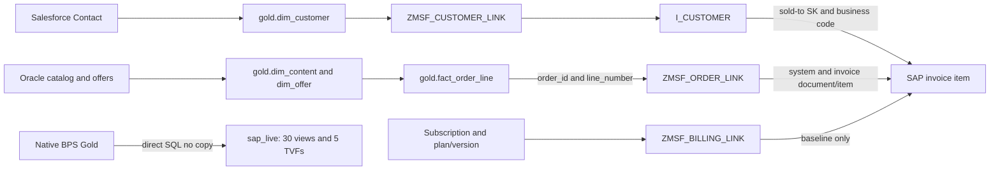
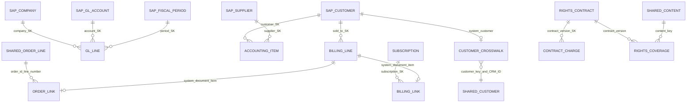

# SAP data model and MSFlix integration

## Verified native scope

Expanded live serving and retirement are verified on 26 October 2026. Native
source: `bps_gold_<system_suffix>.dbo`, system `S4M`, companies **1710/EUR, 1720/CAD,
1730/CHF**. `MSFlixGold.sap_live` exposes **35 SQL interfaces (30 views, five
inline TVFs)** without Warehouse business copies. **24 legacy copies and nine
legacy views were actually retired**, with verified post-commit proof: all 35
interface checks and 20 expanded checks passed, `data_verified=true`.

Observed scope: 1,092 invoice/credit items (four baseline November SVOD items and
1,088 October operational TVOD/EST items), 700 real native customers, 7,642 GL
lines and 7,642 operational accounting items. Counts describe this observation,
not schema/renderer limits. Salesforce, Oracle, operational Gold and workers are
unchanged. **Cockpit not modified or integrated; Planning pending.** Native BPS
schedules remain enabled at **10:00 UTC B2S** and **13:00 UTC S2G** daily.

## 1. Native facts, grains and compound keys

All business grains below include `_SystemName`; preserve company/year/ledger
where present. Document or customer code alone is never a universal join key.

| Native fact | Business grain, in addition to `_SystemName` | Purpose |
|---|---|---|
| `I_GLACCOUNTLINEITEMRAWDATA` | `COMPANYCODE, FISCALYEAR, ACCOUNTINGDOCUMENT, SOURCELEDGER, LEDGERGLLINEITEM` | General ledger: revenue, costs, bank, VAT, AR/AP |
| `I_OPERATIONALACCTGDOCITEM` | `COMPANYCODE, FISCALYEAR, ACCOUNTINGDOCUMENT, ACCOUNTINGDOCUMENTITEM` | Accounting items, customer D/supplier K, payment/clearing dates; no native source-ledger column |
| `C_BILLINGDOCITEMBASICDEX_1` | `BILLINGDOCUMENT, BILLINGDOCUMENTITEM`; retain company/year context | Customer invoices and credits, net/tax/gross |
| `ZMSF_BILLING_LINK` | `BILLINGDOCUMENT, BILLINGDOCUMENTITEM` | Baseline subscription/service period and original invoice |
| `ZMSF_ORDER_LINK` | `BILLINGDOCUMENT, BILLINGDOCUMENTITEM` | Operational `(ORDER_ID, ORDER_LINE_NUMBER)`, customer SK and original credit invoice/item |
| `ZMSF_CONTRACT_CHARGE` | `CONTRACT_ID, VERSION, PERIOD_START, CHARGE_TYPE` | Fictional contract charges; accounting document company/year retained |

GL and operational items are projections of the same journal, not additive
revenues. Invoice, recognition and payment are different events. Aggregate each
fact at its own grain before reconciliation; do not multiply charges by the
number of films covered by a contract.

## 2. Dimensions, SK and dictionary

`Key` is a native dimension surrogate; `_key_*` references it from facts.
Keep SK, business key and `_SystemName` together. SK columns are observed physical
columns, not declared SQL FK constraints; BPS rebuilds may reassign them.
`Key=-1` / null system is the native global unknown, not a real customer/company.
Sold-to, payer, bill-to and ship-to are different roles. Cost/profit centers and
hierarchies require controlling area and validity dates, not a code-only join.

### Current serving dictionary — 24 native objects

The [JSON dictionary](assets/sap-native-model.json) uses the current native catalog
and retains types, precision/scale, maximum length, nullability, ordinal position
and system-qualified `compound_key`. It contains metadata only, no business rows.

| Native object | Business key (add `_SystemName`) | Observed columns |
|---|---|---|
| `I_COMPANYCODE` | `COMPANYCODE` | 15 |
| `I_GLACCOUNTINCHARTOFACCOUNTS` | `CHARTOFACCOUNTS , GLACCOUNT` | 12 |
| `I_FISCALPERIODFORVARIANT` | `FISCALPERIOD , FISCALYEAR , FISCALYEARVARIANT` | 17 |
| `I_FISCALYEARFORCOMPANYCODE` | `COMPANYCODE , FISCALYEAR` | 10 |
| `I_FISCALYEARVARIANT` | `FISCALYEARVARIANT` | 10 |
| `I_SUPPLIER` | `SUPPLIER` | 10 |
| `I_PRODUCT` | `PRODUCT` | 10 |
| `I_COSTCENTER` | `CONTROLLINGAREA , COSTCENTER , VALIDITYENDDATE` | 87 |
| `I_PROFITCENTER` | `CONTROLLINGAREA , PROFITCENTER , VALIDITYENDDATE` | 43 |
| `I_GLACCOUNTHIERARCHYNODE` | `GLACCOUNTHIERARCHY , HIERARCHYNODE , VALIDITYENDDATE , PARENTNODE , HIERARCHYVERSION , CHARTOFACCOUNTS` | 15 |
| `I_COSTCENTERHIERARCHYNODE` | `CONTROLLINGAREA , COSTCENTERHIERARCHY , HIERARCHYNODE , VALIDITYENDDATE` | 14 |
| `I_PROFITCENTERHIERARCHYNODE` | `CONTROLLINGAREA , HIERARCHYNODE , PROFITCENTERHIERARCHY , VALIDITYENDDATE` | 14 |
| `ZMSF_CUSTOMER_LINK` | `CUSTOMER` | 9 |
| `ZMSF_PLAN` | `PLAN_ID , VERSION` | 18 |
| `ZMSF_SUBSCRIPTION` | `SUBSCRIPTION_ID` | 14 |
| `ZMSF_RIGHTS_CONTRACT` | `CONTRACT_ID , VERSION` | 16 |
| `ZMSF_RIGHTS_COVERAGE` | `CONTRACT_ID , VERSION , CONTENT_KEY , TERRITORY , USAGE_TYPE` | 16 |
| `ZMSF_BILLING_LINK` | `BILLINGDOCUMENT , BILLINGDOCUMENTITEM` | 14 |
| `ZMSF_CONTRACT_CHARGE` | `CONTRACT_ID , VERSION , PERIOD_START , CHARGE_TYPE` | 17 |
| `C_BILLINGDOCITEMBASICDEX_1` | `BILLINGDOCUMENT , BILLINGDOCUMENTITEM` | 70 |
| `I_GLACCOUNTLINEITEMRAWDATA` | `ACCOUNTINGDOCUMENT , COMPANYCODE , FISCALYEAR , LEDGERGLLINEITEM , SOURCELEDGER` | 103 |
| `I_OPERATIONALACCTGDOCITEM` | `COMPANYCODE , ACCOUNTINGDOCUMENT , FISCALYEAR , ACCOUNTINGDOCUMENTITEM` | 94 |
| `I_CUSTOMER` | `CUSTOMER` | 10 |
| `ZMSF_ORDER_LINK` | `BILLINGDOCUMENT , BILLINGDOCUMENTITEM` | 15 |

The dictionary describes the serving scope, not every SAP module. Referenced
standard dimensions outside that scope remain native BPS objects. The renderer
reads the catalog, not a four-invoice fixture or a 1710-only schema. Raw views
retain native fields including watermarks, markers and SK; only identified Delta
transport fields `_commit_version` / `_change_type` are excluded.

### Native fact–dimension relationships

Relationships below are sourced from the versioned BPS contract and current SK
columns. This metadata alone does not prove future orphan-free data. Shared
identity and operational bridge checks were separately verified for this run.
Every business predicate is also system-qualified, except the explicit native
global-unknown-member fallback.

| Fact | Dimension | Native SK | Contract predicate |
|---|---|---|---|
| `C_BILLINGDOCITEMBASICDEX_1` | `I_BILLINGDOCUMENTTYPE` | `_key_IBILLINGDOCUMENTTYPE` | `BILLINGDOCUMENTTYPE == BILLINGDOCUMENTTYPE` |
| `C_BILLINGDOCITEMBASICDEX_1` | `I_BILLINGPLANRULE` | `_key_IBILLINGPLANRULE` | `BILLINGPLANRULE == BILLINGPLANRULE` |
| `C_BILLINGDOCITEMBASICDEX_1` | `I_BUSINESSAREA` | `_key_IBUSINESSAREA` | `BUSINESSAREA == BUSINESSAREA` |
| `C_BILLINGDOCITEMBASICDEX_1` | `I_COMPANYCODE` | `_key_ICOMPANYCODE` | `COMPANYCODE == COMPANYCODE` |
| `C_BILLINGDOCITEMBASICDEX_1` | `I_CONTROLLINGAREA` | `_key_ICONTROLLINGAREA` | `CONTROLLINGAREA == CONTROLLINGAREA` |
| `C_BILLINGDOCITEMBASICDEX_1` | `I_COSTCENTER` | `_key_ICOSTCENTER` | `COSTCENTER == COSTCENTER`; `CONTROLLINGAREA == CONTROLLINGAREA` |
| `C_BILLINGDOCITEMBASICDEX_1` | `I_CUSTOMER` | `_key_ICUSTOMERPayerParty` | `PAYERPARTY == CUSTOMER` |
| `C_BILLINGDOCITEMBASICDEX_1` | `I_CUSTOMER` | `_key_ICUSTOMERBillToParty` | `BILLTOPARTY == CUSTOMER` |
| `C_BILLINGDOCITEMBASICDEX_1` | `I_CUSTOMER` | `_key_ICUSTOMERShipToParty` | `SHIPTOPARTY == CUSTOMER` |
| `C_BILLINGDOCITEMBASICDEX_1` | `I_CUSTOMER` | `_key_ICUSTOMERSoldToParty` | `SOLDTOPARTY == CUSTOMER` |
| `C_BILLINGDOCITEMBASICDEX_1` | `I_CUSTOMERGROUP` | `_key_ICUSTOMERGROUP` | `CUSTOMERGROUP == CUSTOMERGROUP` |
| `C_BILLINGDOCITEMBASICDEX_1` | `I_DISTRIBUTIONCHANNEL` | `_key_IDISTRIBUTIONCHANNEL` | `DISTRIBUTIONCHANNEL == DISTRIBUTIONCHANNEL` |
| `C_BILLINGDOCITEMBASICDEX_1` | `I_DIVISION` | `_key_IDIVISION` | `DIVISION == DIVISION` |
| `C_BILLINGDOCITEMBASICDEX_1` | `I_FISCALPERIODFORVARIANT` | `_key_IFISCALPERIODFORVARIANT` | `FISCALYEARVARIANT == FISCALYEARVARIANT`; `BILLINGDOCUMENTDATE >= FISCALPERIODSTARTDATE`; `BILLINGDOCUMENTDATE <= FISCALPERIODENDDATE` |
| `C_BILLINGDOCITEMBASICDEX_1` | `I_OVERALLBILLINGSTATUS` | `_key_IOVERALLBILLINGSTATUS` | `OVERALLBILLINGSTATUS == OVERALLBILLINGSTATUS` |
| `C_BILLINGDOCITEMBASICDEX_1` | `I_PERSONWORKAGREEMENT_1` | `_key_IPERSONWORKAGREEMENT1` | `SALESEMPLOYEE == PERSONWORKAGREEMENT` |
| `C_BILLINGDOCITEMBASICDEX_1` | `I_PLANT` | `_key_IPLANT` | `PLANT == PLANT` |
| `C_BILLINGDOCITEMBASICDEX_1` | `I_PRODUCT` | `_key_IPRODUCT` | `PRODUCT == PRODUCT` |
| `C_BILLINGDOCITEMBASICDEX_1` | `I_PRODUCTGROUP_2` | `_key_IPRODUCTGROUP2` | `PRODUCTGROUP == PRODUCTGROUP` |
| `C_BILLINGDOCITEMBASICDEX_1` | `I_PROFITCENTER` | `_key_IPROFITCENTER` | `PROFITCENTER == PROFITCENTER`; `CONTROLLINGAREA == CONTROLLINGAREA` |
| `C_BILLINGDOCITEMBASICDEX_1` | `I_SALESORGANIZATION` | `_key_ISALESORGANIZATION` | `SALESORGANIZATION == SALESORGANIZATION` |
| `C_BILLINGDOCITEMBASICDEX_1` | `I_SHIPPINGPOINT` | `_key_ISHIPPINGPOINT` | `SHIPPINGPOINT == SHIPPINGPOINT` |
| `I_GLACCOUNTLINEITEMRAWDATA` | `I_ACCOUNTINGDOCUMENTTYPE` | `_key_IACCOUNTINGDOCUMENTTYPE` | `ACCOUNTINGDOCUMENTTYPE == ACCOUNTINGDOCUMENTTYPE` |
| `I_GLACCOUNTLINEITEMRAWDATA` | `I_BUSINESSAREA` | `_key_IBUSINESSAREA` | `BUSINESSAREA == BUSINESSAREA` |
| `I_GLACCOUNTLINEITEMRAWDATA` | `I_CHARTOFACCOUNTS` | `_key_ICHARTOFACCOUNTS` | `CHARTOFACCOUNTS == CHARTOFACCOUNTS` |
| `I_GLACCOUNTLINEITEMRAWDATA` | `I_COMPANYCODE` | `_key_ICOMPANYCODE` | `COMPANYCODE == COMPANYCODE` |
| `I_GLACCOUNTLINEITEMRAWDATA` | `I_CONTROLLINGAREA` | `_key_ICONTROLLINGAREA` | `CONTROLLINGAREA == CONTROLLINGAREA` |
| `I_GLACCOUNTLINEITEMRAWDATA` | `I_COSTCENTER` | `_key_ICOSTCENTER` | `COSTCENTER == COSTCENTER`; `CONTROLLINGAREA == CONTROLLINGAREA` |
| `I_GLACCOUNTLINEITEMRAWDATA` | `I_COSTCENTERACTIVITYTYPE` | `_key_ICOSTCTRACTIVITYTYPE` | `COSTCTRACTIVITYTYPE == COSTCTRACTIVITYTYPE`; `CONTROLLINGAREA == CONTROLLINGAREA` |
| `I_GLACCOUNTLINEITEMRAWDATA` | `I_CUSTOMER` | `_key_ICUSTOMER` | `CUSTOMER == CUSTOMER` |
| `I_GLACCOUNTLINEITEMRAWDATA` | `I_CUSTOMERGROUP` | `_key_ICUSTOMERGROUP` | `CUSTOMERGROUP == CUSTOMERGROUP` |
| `I_GLACCOUNTLINEITEMRAWDATA` | `I_DEBITCREDITCODE` | `_key_IDEBITCREDITCODE` | `DEBITCREDITCODE == DEBITCREDITCODE` |
| `I_GLACCOUNTLINEITEMRAWDATA` | `I_EQUIPMENT` | `_key_IEQUIPMENT` | `EQUIPMENT == EQUIPMENT` |
| `I_GLACCOUNTLINEITEMRAWDATA` | `I_FISCALPERIODFORVARIANT` | `_key_IFISCALPERIODFORVARIANT` | `FISCALYEARVARIANT == FISCALYEARVARIANT`; `FISCALYEAR == FISCALYEAR`; `FISCALPERIOD == FISCALPERIOD` |
| `I_GLACCOUNTLINEITEMRAWDATA` | `I_FISCALYEARFORCOMPANYCODE` | `_key_IFISCALYEARFORCOMPANYCODE` | `COMPANYCODE == COMPANYCODE`; `FISCALYEAR == FISCALYEAR` |
| `I_GLACCOUNTLINEITEMRAWDATA` | `I_FISCALYEARVARIANT` | `_key_IFISCALYEARVARIANT` | `FISCALYEARVARIANT == FISCALYEARVARIANT` |
| `I_GLACCOUNTLINEITEMRAWDATA` | `I_FIXEDASSET` | `_key_IFIXEDASSET` | `COMPANYCODE == COMPANYCODE`; `FIXEDASSET == FIXEDASSET`; `MASTERFIXEDASSET == MASTERFIXEDASSET` |
| `I_GLACCOUNTLINEITEMRAWDATA` | `I_FUNCTIONALAREA` | `_key_IFUNCTIONALAREA` | `FUNCTIONALAREA == FUNCTIONALAREA` |
| `I_GLACCOUNTLINEITEMRAWDATA` | `I_FUNCTIONALLOCATION` | `_key_IFUNCTIONALLOCATION` | `FUNCTIONALLOCATION == FUNCTIONALLOCATION` |
| `I_GLACCOUNTLINEITEMRAWDATA` | `I_GLACCOUNTINCHARTOFACCOUNTS` | `_key_IGLACCOUNTINCHARTOFACCOUNTS` | `GLACCOUNT == GLACCOUNT`; `CHARTOFACCOUNTS == CHARTOFACCOUNTS` |
| `I_GLACCOUNTLINEITEMRAWDATA` | `I_GLOBALCOMPANY` | `_key_IGLOBALCOMPANYPartnerCompany` | `COMPANY == COMPANY` |
| `I_GLACCOUNTLINEITEMRAWDATA` | `I_GLOBALCOMPANY` | `_key_IGLOBALCOMPANYCompany` | `PARTNERCOMPANY == COMPANY` |
| `I_GLACCOUNTLINEITEMRAWDATA` | `I_LEDGER` | `_key_ILEDGER` | `SOURCELEDGER == LEDGER` |
| `I_GLACCOUNTLINEITEMRAWDATA` | `I_PLANT` | `_key_IPLANT` | `PLANT == PLANT` |
| `I_GLACCOUNTLINEITEMRAWDATA` | `I_PRODUCT` | `_key_IPRODUCT` | `PRODUCT == PRODUCT` |
| `I_GLACCOUNTLINEITEMRAWDATA` | `I_PRODUCTGROUP_2` | `_key_IPRODUCTGROUP2` | `PRODUCTGROUP == PRODUCTGROUP` |
| `I_GLACCOUNTLINEITEMRAWDATA` | `I_PROFITCENTER` | `_key_IPROFITCENTER` | `PROFITCENTER == PROFITCENTER`; `CONTROLLINGAREA == CONTROLLINGAREA` |
| `I_GLACCOUNTLINEITEMRAWDATA` | `I_SEGMENT` | `_key_ISEGMENT` | `SEGMENT == SEGMENT` |
| `I_GLACCOUNTLINEITEMRAWDATA` | `I_SUPPLIER` | `_key_ISUPPLIER` | `SUPPLIER == SUPPLIER` |
| `I_GLACCOUNTLINEITEMRAWDATA` | `I_WBSELEMENTDATA_2` | `_key_IWBSELEMENTDATA_2` | `WBSELEMENTINTERNALID == WBSELEMENTINTERNALID` |
| `I_OPERATIONALACCTGDOCITEM` | `I_ACCOUNTINGDOCUMENTCATEGORY` | `_key_IACCOUNTINGDOCUMENTCATEGORY` | `ACCOUNTINGDOCUMENTCATEGORY == ACCOUNTINGDOCUMENTCATEGORY` |
| `I_OPERATIONALACCTGDOCITEM` | `I_ACCOUNTINGDOCUMENTTYPE` | `_key_IACCOUNTINGDOCUMENTTYPE` | `ACCOUNTINGDOCUMENTTYPE == ACCOUNTINGDOCUMENTTYPE` |
| `I_OPERATIONALACCTGDOCITEM` | `I_BUSINESSAREA` | `_key_IBUSINESSAREA` | `BUSINESSAREA == BUSINESSAREA` |
| `I_OPERATIONALACCTGDOCITEM` | `I_CHARTOFACCOUNTS` | `_key_ICHARTOFACCOUNTS` | `CHARTOFACCOUNTS == CHARTOFACCOUNTS` |
| `I_OPERATIONALACCTGDOCITEM` | `I_COMPANYCODE` | `_key_ICOMPANYCODE` | `COMPANYCODE == COMPANYCODE` |
| `I_OPERATIONALACCTGDOCITEM` | `I_CONTROLLINGAREA` | `_key_ICONTROLLINGAREA` | `CONTROLLINGAREA == CONTROLLINGAREA` |
| `I_OPERATIONALACCTGDOCITEM` | `I_COSTCENTER` | `_key_ICOSTCENTER` | `COSTCENTER == COSTCENTER`; `CONTROLLINGAREA == CONTROLLINGAREA` |
| `I_OPERATIONALACCTGDOCITEM` | `I_CUSTOMER` | `_key_ICUSTOMER` | `CUSTOMER == CUSTOMER` |
| `I_OPERATIONALACCTGDOCITEM` | `I_CUSTOMERPAYMENTTERMS` | `_key_ICUSTOMERPAYMENTTERMS` | `PAYMENTTERMS == CUSTOMERPAYMENTTERMS` |
| `I_OPERATIONALACCTGDOCITEM` | `I_DEBITCREDITCODE` | `_key_IDEBITCREDITCODE` | `DEBITCREDITCODE == DEBITCREDITCODE` |
| `I_OPERATIONALACCTGDOCITEM` | `I_DUNNINGAREA` | `_key_IDUNNINGAREA` | `DUNNINGAREA == DUNNINGAREA`; `COMPANYCODE == COMPANYCODE` |
| `I_OPERATIONALACCTGDOCITEM` | `I_DUNNINGKEY` | `_key_IDUNNINGKEY` | `DUNNINGKEY == DUNNINGKEY` |
| `I_OPERATIONALACCTGDOCITEM` | `I_FISCALYEARFORCOMPANYCODE` | `_key_IFISCALYEARFORCOMPANYCODE` | `COMPANYCODE == COMPANYCODE`; `FISCALYEAR == FISCALYEAR` |
| `I_OPERATIONALACCTGDOCITEM` | `I_GLACCOUNTINCHARTOFACCOUNTS` | `_key_IGLACCOUNTINCHARTOFACCOUNTS` | `GLACCOUNT == GLACCOUNT`; `CHARTOFACCOUNTS == CHARTOFACCOUNTS` |
| `I_OPERATIONALACCTGDOCITEM` | `I_PAYMENTBLOCKINGREASON` | `_key_IPAYMENTBLOCKINGREASON` | `PAYMENTBLOCKINGREASON == PAYMENTBLOCKINGREASON` |
| `I_OPERATIONALACCTGDOCITEM` | `I_PAYMENTTERMS` | `_key_IPAYMENTTERMS` | `PAYMENTTERMS == PAYMENTTERMS` |
| `I_OPERATIONALACCTGDOCITEM` | `I_POSTINGKEY` | `_key_IPOSTINGKEY` | `POSTINGKEY == POSTINGKEY` |
| `I_OPERATIONALACCTGDOCITEM` | `I_PROFITCENTER` | `_key_IPROFITCENTER` | `PROFITCENTER == PROFITCENTER`; `CONTROLLINGAREA == CONTROLLINGAREA` |
| `I_OPERATIONALACCTGDOCITEM` | `I_SPECIALGLCODE` | `_key_ISPECIALGLCODE` | `SPECIALGLCODE == SPECIALGLCODE` |
| `I_OPERATIONALACCTGDOCITEM` | `I_SUPPLIER` | `_key_ISUPPLIER` | `SUPPLIER == SUPPLIER` |
| `I_OPERATIONALACCTGDOCITEM` | `I_FISCALPERIODFORVARIANT` | `_key_IFISCALPERIODFORVARIANT` | `FISCALYEARVARIANT == FISCALYEARVARIANT`; `POSTINGDATE >= FISCALPERIODSTARTDATE`; `POSTINGDATE <= FISCALPERIODENDDATE` |
| `ZMSF_BILLING_LINK` | `ZMSF_SUBSCRIPTION` | `_key_ZMSFSUBSCRIPTION` | `SUBSCRIPTION_ID == SUBSCRIPTION_ID` |
| `ZMSF_CONTRACT_CHARGE` | `ZMSF_RIGHTS_CONTRACT` | `_key_ZMSFRIGHTSCONTRACT` | `CONTRACT_ID == CONTRACT_ID`; `VERSION == VERSION` |
| `ZMSF_ORDER_LINK` | `I_CUSTOMER` | `_key_ICUSTOMER` | `CUSTOMER == CUSTOMER` |

## 3. Salesforce versus Oracle/operational paths

### Customer identity path

**Salesforce Contact → `gold.dim_customer` → native `ZMSF_CUSTOMER_LINK` →
`I_CUSTOMER` → SAP invoice sold-to SK.**

Crosswalk `CUSTOMER_KEY = gold.dim_customer.customer_key` and
`SALESFORCE_CONTACT_ID = gold.dim_customer.source_customer_id` must both agree.
Within SAP, join crosswalk/customer by `( _SystemName, CUSTOMER )`, then invoice
`_key_ICUSTOMERSoldToParty` to native `Key`, verifying `SOLDTOPARTY = CUSTOMER`.
All 1,092 invoice customer/CRM mappings passed; this is identity evidence, not
marketing attribution or proof that every order by that customer was invoiced.

### Catalog, order and invoice path

**Oracle catalog/product/offers → `gold.dim_content` / `gold.dim_offer` → shared
`gold.fact_order_line` → native `ZMSF_ORDER_LINK` → SAP invoice item.**

The shared order grain `(order_id, line_number)` joins bridge
`(ORDER_ID, ORDER_LINE_NUMBER)`; bridge `( _SystemName, BILLINGDOCUMENT,
BILLINGDOCUMENTITEM )` joins the invoice. Native product and shared content/offer
references must agree with the bridged order, as must customer and currency;
no implicit SAP-product/Oracle-offer equivalence or client-only invoice join.
All 1,088 operational bridge rows passed shared order/customer/currency checks.
The bridge customer business code and `_key_ICUSTOMER` must match invoice
sold-to code and SK. Credits retain original invoice **and item** references.

The baseline is separate: `ZMSF_BILLING_LINK` → `ZMSF_SUBSCRIPTION` → `ZMSF_PLAN`
by plan/version → contract/version. Its four items retain null `ORDER_ID` and are
not operational orders. `billing_linkage_type` makes this partition explicit;
dual, missing, conflicting or wrong-customer bridges block qualification.

### Content costs and attribution limits

`ZMSF_RIGHTS_COVERAGE.CONTENT_KEY` links shared content; distributor key preserves
catalog provenance, not proof of a real commercial agreement. Null Oracle
distributors remain unknown. Contract/version and native contract SK link
`ZMSF_CONTRACT_CHARGE` to rights contract; supplier code/system links the fictional
supplier. Portfolio coverage is not a per-film allocation. Campaign → SAP revenue
still requires explicit operational attribution; a nearby touch is insufficient.
No new cockpit feed or write to shared Gold is implied by these logical paths.

## 4. Logical diagrams

[Standalone visual model](assets/sap-msflix-model.html) ·
[Metadata dictionary](assets/sap-native-model.json).

Cardinalities are the qualified logical contract, not declared SQL constraints or
future coverage guarantees. A billing item uses exactly one subscription or
operational bridge, not both. Credits can reference a previously invoiced order.

## 5. Consumption and financial safeguards

See [SQL contract and operations](SAP-ZERO-COPY.md) for all 35 interfaces and the
15 tested monetary interfaces. Preserve monetary facts; cardinality-safe mapping
resolution collapses identical mapping duplicates with diagnostic counts but
leaves conflicting mappings unresolved, never picks an arbitrary winner. Native
markers are exposed, not assumed deleted. Missing amounts, unknown/mismatched SK,
account completeness and conflicting versions must be qualified before metrics.

Operational demo prices include illustrative **20% tax**. Invoicing occurs at
order time, recognition at first observed playback, receipts are simulated,
arrears and refunds explicit. Operational fictional content cost is 20% of
recognized net revenue after credits, calculated per currency with partial
supplier settlement; baseline contract charges remain distinct. No real tax
policy or FX is implied. EUR/CAD/CHF remain separate, as do ledgers. Subscription,
TVOD, EST, operational and total measures overlap: do not add their totals twice.

Use explicit as-of dates for open items/payments. A business cutoff is not an
immutable snapshot: native corrections may change past-date readings. Distinguish
read time, native watermark and completed BPS jobs. Do not substitute legacy
`sap_publication` or operational publication for SAP freshness. Future Planning
and cockpit permissions/integration require their own validation.

## 6. Evidence and limits

- `.state/sap/zero-copy/expanded-preflight/run-20261026T084421Z/`: native catalog,
  qualification and independent financial reconciliation (72 matched cells).
- `.state/sap/zero-copy/deployment-integration/retirement-journal.json`: verified
  retirement with all 35 interface and 20 expanded checks passing.
- [BPS input contract](../sources/sap/contracts/native-input-v1.json) and
  [serving renderer](../sources/sap/zero_copy_serving.py): versioned keys/relations
  and current-catalog SQL semantics.

Raw proofs remain local and ignored. Documents commit metadata and aggregate
counts only, never business rows or credentials. Native BPS data was not dropped;
retired Warehouse table history was removed. Recovery repairs zero-copy rather
than re-enabling the legacy Warehouse publisher. Dynamic external consumers
cannot all be disproved by catalog dependencies; retirement authorization scoped
only the named legacy SAP objects. Cockpit not modified/integrated, Planning pending.
